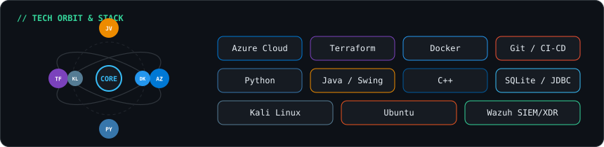
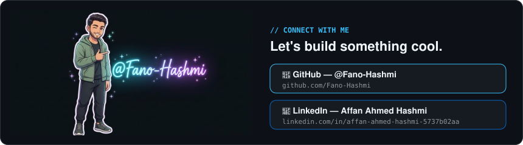

  

<table>
  <tr>
    <td></td>
    <td></td>
  </tr>
</table>

 

  

  

<h3><code>affan@github ~ $ ls ./featured-projects</code></h3>

| Project | Tech | Focus |
| :--- | :--- | :--- |
| [**Event-Management-System**](https://github.com/Fano-Hashmi/Event-Management-System) | Java, Swing, SQLite, Sockets | Desktop event management system using JDBC, MVC/DAO architecture, and custom data structures |
| [**-Cipher-Desktop-Base-AI-**](https://github.com/Fano-Hashmi/-Cipher-Desktop-Base-AI-) | Python | Desktop-based AI assistant & automation project |
| [**Hotel-Management-**](https://github.com/Fano-Hashmi/Hotel-Management-) | Java | OOP, GUI development, data structures, and system design |
| [**Practise**](https://github.com/Fano-Hashmi/Practise) | HTML | Web fundamentals and regular coding practice |

 

  

